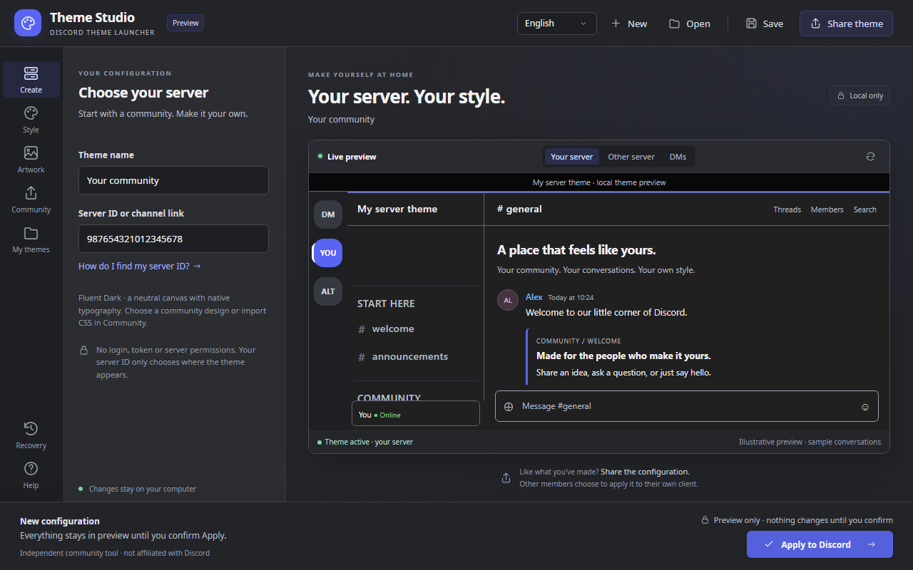
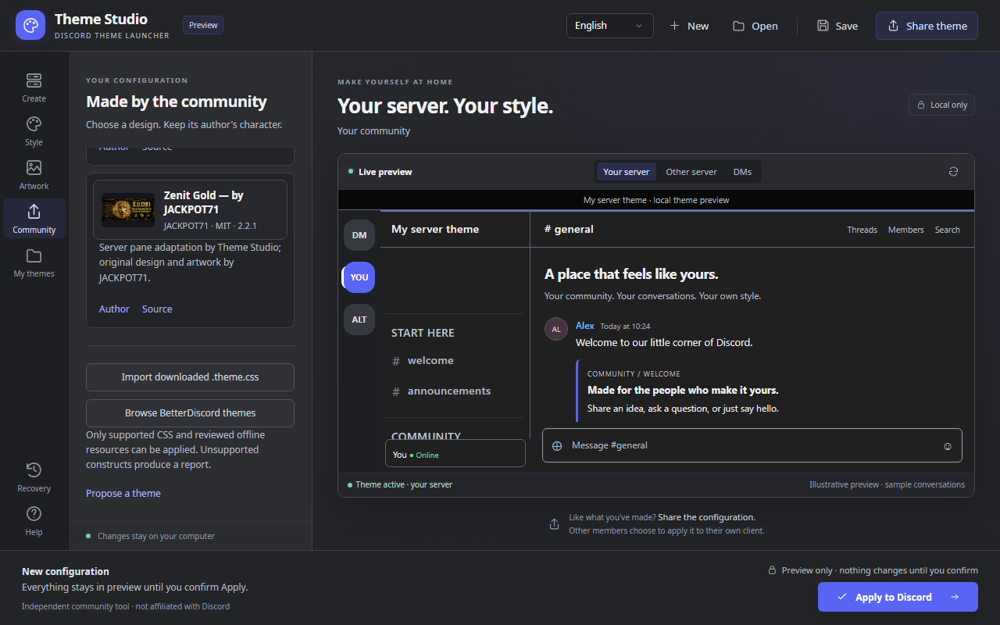

# Theme Studio · Discord Theme Launcher

Create, edit, preview and share a Discord theme for the server you choose. Start with neutral **Fluent Dark**, customize a community design, or import a compatible downloaded BetterDiscord `.theme.css`. Review it before applying and restore your previous setup when needed.

**Changes affect your local Discord client.** Other members choose whether to install a shared theme themselves. This app does not alter a server for everyone, discover membership, read messages, or request Discord credentials.

This branch prepares **0.3.0-beta.8** as a draft, not a public release. Build a portable candidate using the commands below. [Published releases](https://github.com/PrimeBuild-pc/discord-theme-launcher/releases) may predate this workflow.



## Create, Community, My themes

1. **Create** starts with charcoal surfaces, a configurable accent, native typography and no artwork or implicit server. Choose your server ID or Discord channel link. An example preview is available before you choose.
2. **Community** offers credited designs and a button to [browse BetterDiscord themes](https://betterdiscord.app/themes). Download a `.theme.css` yourself, then choose **Import downloaded .theme.css**. Review compatibility and resources before accepting it.
3. Preview the actual design. **Style** and **Artwork** expose its capabilities. Imported CSS exposes supported author color/numeric variables; source artwork and typography remain intact. Other-server and DM previews demonstrate isolation.
4. **My themes** opens, saves and shares `.dtheme` configurations with assets, licenses, source bytes and edits. **Export original CSS** preserves imported bytes exactly. One personal theme is active at a time; you can keep multiple saved files.
5. **Apply to Discord** reviews the design and target. Finish calls/streams and save drafts. Only **Continue & apply** authorizes changes and a Discord restart. **Back to preview** or Esc cancels. Required official Vencord setup is offered with explicit consent.
6. **Recovery** disables the personal theme or restores exact previous managed files and enablement. Other themes, plugins, QuickCSS, online links, runtime files and unrelated preferences remain intact. Earlier configurations and backups remain supported.

English, Italian, Spanish, Russian and **German** are available from the header. The language persists for the Windows user; documentation remains English. Controls support keyboard navigation and visible focus.

## Community designs

| Design | Author / source | License and capabilities |
| --- | --- | --- |
| Prime Build — Build Your Dream | [PrimeBuild-pc](https://github.com/PrimeBuild-pc/discord-theme-launcher) | MIT; palette, typography and artwork |
| Prime Build Dev — Software House | [PrimeBuild-pc](https://github.com/PrimeBuild-pc/discord-theme-launcher) | MIT; palette, typography and artwork |
| FantaFort — Arena | [PrimeBuild-pc](https://github.com/PrimeBuild-pc/discord-theme-launcher) | MIT; palette, typography and artwork |
| **Zenit Gold — by JACKPOT71** | [JACKPOT71](https://github.com/JACKPOT71) · [zenit-gold](https://github.com/JACKPOT71/zenit-gold) | MIT; original gold design, banner and mascot; supported variables; explicit server-pane adaptation |

Zenit v2.2.1 is pinned to commit `64cc7a1eaf77dc3b081d5fd0637d8dc165b273c6`. Copyright © 2026 ZENIT / Jackpot and the [original MIT license](assets/community/zenit-gold/LICENSE) are retained. Server adaptation is by Theme Studio, with author consent supplied by Lorenzo. Montserrat is bundled from pinned Google Fonts source under [SIL OFL 1.1](assets/community/zenit-gold/font/OFL.txt); preview makes no Google Fonts request.



## Compatible CSS import, with limits

This is a **supported subset**, not universal BetterDiscord compatibility. A native parser retains the imported design and confines supported rules to the chosen server pane. It handles root rules, embedded images, grouping rules, named animations and contained fixed backgrounds. It does not substitute a built-in preset.

Remote/relative resources, unknown global rules, nested CSS, unsafe document-root layouts and unsupported font/import registrations produce a report before accepting the file. No arbitrary preview resources are fetched. The pinned Zenit font import has a reviewed offline adapter. Global settings and detached portals retain their normal appearance. Obsolete third-party Discord selectors may have no effect.

CSS source is limited to 2 MiB; `.dtheme` to 24 MiB. Source and SHA-256 are retained and revalidated on reopen/apply. Original CSS export may be global when installed directly elsewhere; share `.dtheme` for the server-targeted workflow. See [the precise compatibility model and pinned provenance](docs/BETTERDISCORD-IMPORT.md).

Custom PNG/JPEG artwork is normalized to PNG, at most 8 MiB, 4096 px per side and 16 million pixels. Static TTF/OTF imports require redistribution and editable embedding rights and a license, at most 2 MiB. Do not redistribute assets without permission. Hashes detect corruption, not authorship or licensing.

## Suggest a theme

**Propose a theme** opens the [submission form](https://github.com/PrimeBuild-pc/discord-theme-launcher/issues/new?template=theme_submission.yml). Supply author/source, a synthetic-data preview, the file or pinned source, and license information. Human review precedes inclusion; submission never installs or publishes automatically.

A maintainer may set `THEME_STUDIO_SUBMISSION_DISCORD` to an existing HTTPS `discord.com/channels/...` or `discord.gg/...` destination before launching. The app validates the host and otherwise uses GitHub. No invite is invented and no upload/email service is deployed.

## Windows setup

The portable build is self-contained .NET 10 for Windows x64. Extract its ZIP and run `DiscordThemeLauncher.exe` normally, without Administrator privileges. The UI requires **Microsoft Edge WebView2 Runtime**, never installed silently. Optional Vencord setup uses its pinned official installer.

Automatic application supports per-user stable Discord and the default Vencord profile. Store/PTB/Canary, custom profiles, unknown loaders, linked folders and other platforms are outside automatic support. The EXE is **unsigned**. No security settings are changed. This independent project is not affiliated with Discord or Vencord; Vencord is unofficial and has terms/account implications.

Read [Installation and recovery](docs/INSTALLATION.md), [Compatibility](docs/COMPATIBILITY.md), [Configuration format](docs/CONFIGURATIONS.md), and [tested/not-tested evidence](docs/THEME-STUDIO-VALIDATION.md).

## Development

Node 22+, .NET 10 SDK and pinned npm dependencies are required. Windows is required for native integration and packaging.

```sh
npm ci
npx playwright install chromium
npm run verify
```

```powershell
dotnet run --project launcher/WindowsTests/WindowsTests.csproj -c Release
./scripts/package-windows.ps1
```

Tests use isolated profiles and synthetic conversations. Native WebView integration is not evidence of human GUI interaction or Windows reboot coverage. No real Discord profile is modified by tests. See [architecture](docs/ARCHITECTURE.md), [acceptance progress](docs/THEME-STUDIO-PROGRESS.md), and the [credited preview for Lorenzo](docs/ZENIT-PREVIEW.md).

## Credits and licenses

Original code/artwork: [MIT](LICENSE), maintained by [PrimeBuild-pc](https://github.com/PrimeBuild-pc). Community names/logos identify their owners. Zenit retains JACKPOT71's copyright and MIT notice. Noto Sans, Rajdhani, JetBrains Mono, Bangers and Montserrat retain SIL OFL notices. Test-only Dracula source retains its [MIT license](tests/imports/dracula/LICENSE). Portable packages include .NET and WebView2 SDK notices. Discord's proprietary fonts and Vencord binaries are not bundled.
