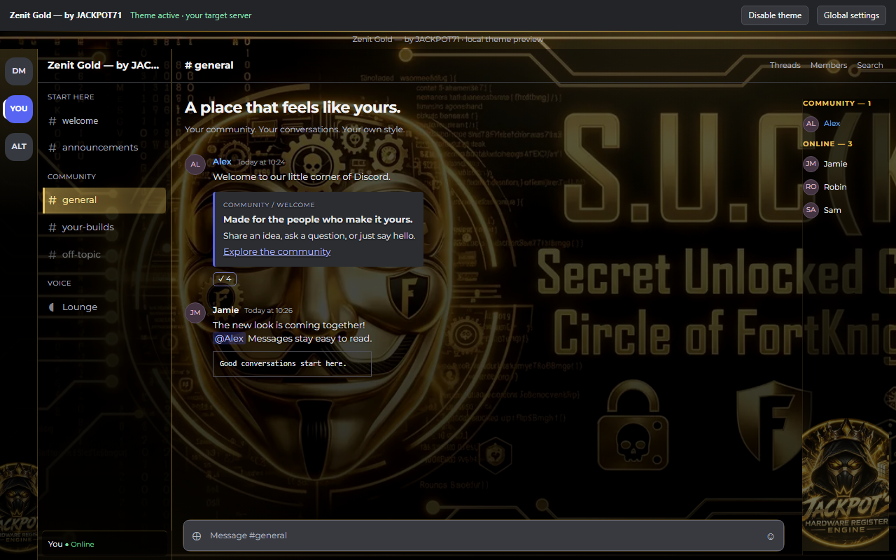

# Preview prepared for Lorenzo

Prepared for Lorenzo to share manually; no message has been sent to JACKPOT71 or a community channel.

> **Zenit Gold — by JACKPOT71** in Theme Studio. The server-pane adaptation keeps JACKPOT71's original gold design, embedded banner and mascot, and uses offline Montserrat. Choose a server, preview the original design, edit supported author variables, and share a portable configuration. Changes are local to each member; other servers, DMs and detached settings retain their normal appearance.
>
> Original author: [JACKPOT71](https://github.com/JACKPOT71). Source: [zenit-gold](https://github.com/JACKPOT71/zenit-gold), v2.2.1, pinned commit `64cc7a1eaf77dc3b081d5fd0637d8dc165b273c6`. Copyright © 2026 ZENIT / Jackpot; MIT license retained. Server adaptation by Theme Studio, with author consent supplied by Lorenzo. This is a draft preview, not a public release or a universal CSS compatibility claim.

The screenshot is a real Chromium rendering of the generated offline preview with synthetic names/messages. It is not a live Discord account or accessible Windows desktop capture. Native Windows/WebView integration is tested separately; real interactive desktop and reboot validation remain pending. Fixed whole-document decorations are intentionally contained to the selected server pane.
